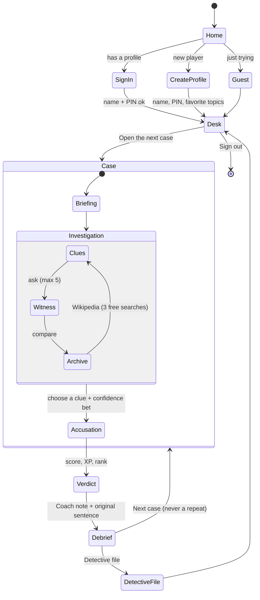
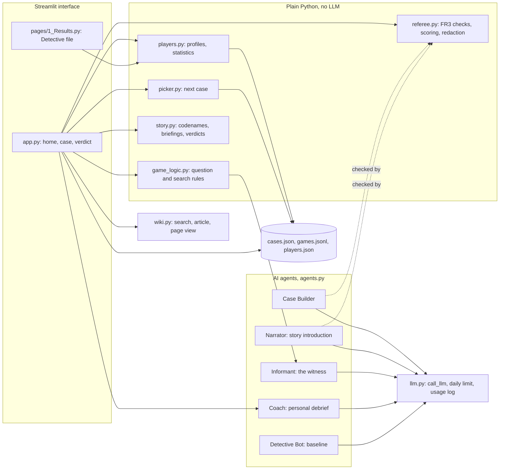
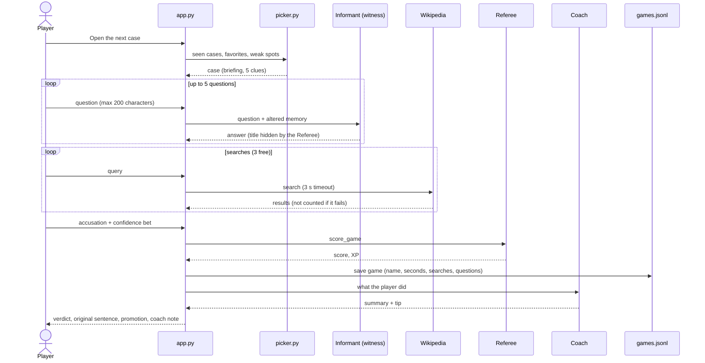
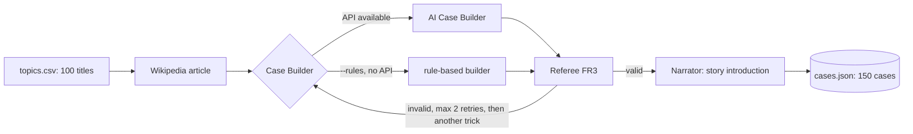
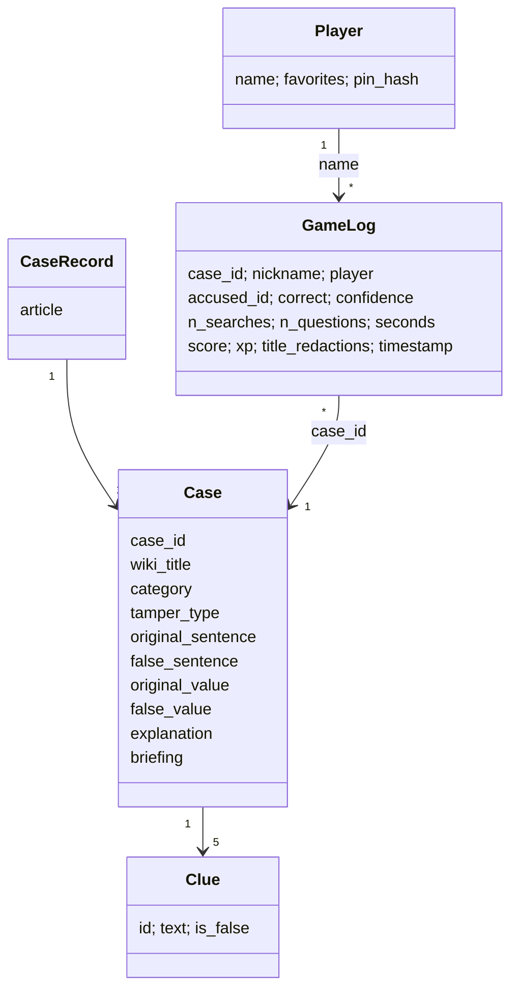

# Wiki Alibi: architecture and user flow

The diagrams below are written in Mermaid. GitHub draws them automatically.

## 1. User flow (what the player sees)

What makes the game remember you: every verdict is written to `games.jsonl` with your name. Your rank, XP,
streaks, weak spots and the list of cases you already met are **computed from that log** each time you sign in.
The next case is chosen by `picker.py` among the cases you have not met, with a preference for your favorite
topics and for the kind of forgery you miss most.

## 2. Components

Every AI agent has an **offline fallback**, so the game is complete without the API:
the witness answers from its memory in character, the Narrator and the Coach use templates, the bot guesses at random.

## 3. One game, step by step

## 4. Case library: how cases are made

## 5. Data model

Player statistics (rank, XP, streaks) are not stored: they are derived from `GameLog`.
